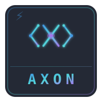
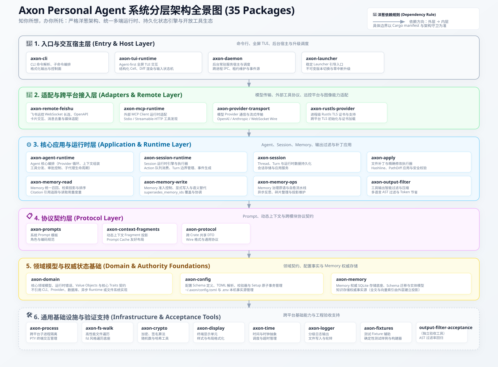

# Axon

<p align="center">
  
</p>

<p align="center">
  <strong>知你所想，办你所托。</strong><br>
  <sub>融入你的工作区与工作节奏，在每一次交互中持续深化认知的专属个人智能体。</sub><br>
  <sub><em>Knowing Your Intent, Delivering Your Outcome - A personal agent deeply woven into your workspace, evolving with every interaction.</em></sub>
</p>

<p align="center">
  <a href="./LICENSE"></a>
  <a href="https://www.rust-lang.org"></a>
  </a>
  <a href="./docs/README.md"></a>
  <a href="https://github.com/a574676848/axon-code/actions/workflows/ci.yml"></a>
</p>

---

Axon 是为个人与工程创造者打造的**专属个人智能体与首席战术副官（Personal Agent & Tactical Aide）**。系统恪守严格的洋葱架构（Onion Architecture），在**跨平台桌面端（Desktop Workbench）**、**终端全屏交互（Terminal TUI）**、**无头命令行（Headless CLI）**与**企业协作入口（飞书远程接入）**之间复用同一套高性能 Agent 运行时、状态机模型、工具权限边界、模型路由以及上下文认知体系。

## 核心特性

- **多端统一运行时 (Unified Multi-Interface Runtime)**：无论从现代化桌面窗口、终端全屏 TUI、非交互命令行 `axon run`，还是企业即时通讯（飞书），均运行在同一底层 Agent 运行时上，实现状态与上下文的无缝漫游。
- **开发者桌面工作台 (Axon Desktop Workbench)**：基于 Tauri 2 构建的工业级桌面端，秉承黑白极简主义设计，支持多工作区与独立任务车道（Lanes）、实时流式 Token 投影、交互式问答卡片（支持单选/多选/输入与自动唤醒）、工作区文件查看器与系统关联应用打开、集成终端和可视化 MCP/模型设置。
- **终端全屏交互 (Terminal TUI)**：基于 Ratatui 构建的高性能终端界面，具备毫秒级首字极速渲染、多状态仪表盘、转录行折叠与交互式问答面板。
- **严格洋葱架构与持久化事实 (Onion Architecture & Durable State)**：领域层 `axon-domain` 绝对解耦；系统以原子入账的 `Interaction`、`Goal` 与 `Execution` 作为单一事实来源，支持分布式排他租约、故障自动恢复与历史精准重放。
- **智能模型路由与容灾 (Model Routing & Failover)**：支持 OpenAI、Anthropic、DeepSeek、Ollama 及兼容 Provider；具备智能负载均衡、自动化 Failover 容灾、流式响应处理与长会话 Prompt Cache 缓存优化。
- **开放工具与扩展生态 (Extensible Tools, MCP & Skills)**：开箱即用内置文件读写、精准代码编辑（Hashline / Add / PathDiff）、Shell 执行、知识检索；无缝接入 Model Context Protocol (MCP) 标准（含 OAuth 认证）与动态加载的自进化 Skill 系统。
- **后台常驻与自动化 (Daemon & Agent Automation)**：轻量级常驻守护进程提供标准 HTTP/WebSocket 网关，支持跨工作区并发调度、长周期异步 Goal 执行、Agent Cron 定时自动化任务及 Token 用量成本审计。
- **不可变发布与平滑升级 (Atomic Upgrades & Zero Degradation)**：采用不可变版本树隔离发布，由稳定 launcher 统一引导启动，保障零停机无痛覆盖升级与服务自愈。

## 架构概览

系统遵循洋葱架构，核心业务模型与基础设施层彻底解耦：

<p align="center">
  
</p>

```text
 [桌面工作台 (Desktop)]   [终端 TUI (Ratatui)]   [无头 CLI (Headless)]   [企业协同 (Feishu)]
           \                       |                      |                      /
            \                      |                      |                     /
             +---------------------+----------------------+--------------------+
                                           |
                                           v
                             [Axon Daemon 守护进程 / 网关]
                                   (HTTP / WebSocket)
                                           |
                                           v
                      [Interaction 状态机与持久化队列 (SQLite)]
                                           |
                                           v
                       [PrimaryTurnService / Execution 调度池]
                                           |
                                           v
                       [Agent Runtime (模型调用 / 工具执行循环)]
                          /                |                \
                         v                 v                 v
                   [LLM Provider]     [内置工具集]       [MCP / Skills]
```

## 快速开始

### 环境要求

| 项目 | 要求 |
|---|---|
| 操作系统 | Windows、macOS、Linux |
| 源码构建 | Rust 1.98.1 及以上（Edition 2024） |
| 桌面端前端构建 | Node.js 22 及以上 |

### 1. 一键安装

**Windows (PowerShell)**:
```powershell
irm https://raw.githubusercontent.com/a574676848/axon-code/master/scripts/install.ps1 | iex
```

**macOS / Linux**:
```bash
curl -fsSL https://raw.githubusercontent.com/a574676848/axon-code/master/scripts/install.sh | sh
```

> 安装程序将自动部署 CLI、稳定 Launcher 以及后台 Daemon 守护进程，并在 `~/.axon/` 初始化用户环境。安装根可用 `AXON_INSTALL_ROOT` 覆盖，默认为 `~/.axon/bin`。

### 2. 交互式初始化

初次使用请运行配置向导设置大模型 Provider 与 API 密钥：

```bash
axon setup
```

### 3. 执行你的第一个任务

**进入交互式终端界面**：
```bash
axon "分析当前仓库的核心架构与主要依赖"
```

**启动桌面工作台**：
```bash
axon desktop
```

**非交互命令行执行（适用于脚本与 CI/CD）**：
```bash
axon run "检查 Cargo.toml 依赖并报告潜在安全风险"
```

## 使用形态

| 形态 | 适用场景 | 启动命令 |
|---|---|---|
| **桌面端工作台 (Desktop)** | 多任务并行、可视化车道管理、复杂问答卡片交互、工程文件协同 | `axon desktop` |
| **终端全屏 (TUI)** | 纯命令行环境、沉浸式开发、低资源占用与高频快捷键操作 | `axon` 或 `axon "prompt"` |
| **无头命令 (Run)** | 单次任务执行、流水线调用、结构化 JSON 输出 | `axon run "prompt"` |
| **后台常驻 (Daemon)** | 异步长周期任务、定时计划 (Cron)、跨应用网络网关、系统监控 | `axon daemon start` |
| **企业协作 (Feishu)** | 移动端远程委派、群聊交互、团队协作与异步卡片通知 | 配置在 `config.toml` 中启用 |

> `axon desktop` 由安装根的稳定 launcher 直接转发给桌面端二进制，因此不会出现在 `axon --help` 的子命令列表中。

## 常用命令

```bash
# 执行任务
axon "解释当前项目的数据结构"                      # 启动 TUI 交互
axon run "为当前项目添加错误处理"                 # 命令行直接运行
axon run --format json "分析测试用例覆盖率"        # 结构化 JSON 格式输出
axon run --continue "继续上一轮未完成的重构"       # 沿用最近一次会话继续执行

# 任务接续与停止
axon stop                                       # 停止当前运行中的任务

# 桌面端
axon desktop                                    # 启动 Axon Desktop 桌面端

# 模型、扩展与配置
axon models                                     # 列出可用模型
axon skills                                     # 查看已加载的 Skill
axon config --help                              # 配置管理子命令
axon memory --help                              # 记忆管理子命令
axon cron --help                                # 用户级 Agent Cron 定时任务

# 系统自检与服务治理
axon doctor                                     # 全链路环境与健康检查
axon daemon status                              # 查看后台守护进程状态
axon daemon restart                             # 重启守护服务
axon usage                                      # 查看 Token 消耗与成本看板
```

完整子命令与参数以 `axon --help`、`axon <COMMAND> --help` 的输出为准，参见 [CLI 命令参考](./docs/cli.md)。

## 文档导航

完整的技术文档与参考资料请访问 [Axon 文档中心](./docs/README.md)：

- **概念与架构**
  - [系统概览](./docs/overview.md) - 系统全景与端到端执行流
  - [核心概念](./docs/concepts.md) - 状态机模型、车道概念与上下文装配
  - [记忆管理系统](./docs/memory-management.md) - 分层认知模型、检索投影与记忆治理
  - [人格系统](./docs/persona.md) - 人设格式、模式推导、人格状态与体积预算
- **使用指南**
  - [快速上手](./docs/quickstart.md) - 安装、配置向导与环境搭建
  - [桌面工作台](./docs/desktop.md) - Axon Desktop 完整操作手册
  - [终端 TUI](./docs/tui.md) - Ratatui 全屏终端操作与按键绑定
  - [CLI 参考手册](./docs/cli.md) - 完整子命令与参数规范
  - [配置指南](./docs/configuration.md) - `config.toml` 配置项深度解析
- **扩展与协同**
  - [大模型 Provider](./docs/providers.md) - 模型路由、参数映射与 Prompt Cache
  - [Daemon 守护进程](./docs/daemon.md) - 网关通信、后台作业与平滑升级
  - [飞书远程协作](./docs/feishu-remote.md) - 私有长连接远控与交互卡片
  - [MCP 协议集成](./docs/mcp.md) - Model Context Protocol 服务器接入
  - [Skill 技能系统](./docs/skills.md) - 自定义技能编写与运行态规范
  - [内置工具契约](./docs/tool-schema.md) - 工具参数 Schema 与行为规约
- **运维与贡献**
  - [使用统计与成本](./docs/usage-statistics.md) - 监控指标、用量审计与模型计费
  - [故障排查](./docs/troubleshooting.md) - 常见问题诊断与修复建议
  - [工作台设计系统](./docs/workbench-design-system.md) - 跨平台桌面端极简浅色设计规范与令牌 SSOT
  - [桌面端 UI 约束规范](./docs/ui-constraints.md) - UI 任务开工前置契约与验收门禁
  - [贡献指南](./CONTRIBUTING.md) - 源码架构分层、规范与开发工作流

## 示例与配置样板

仓库内置可直接参照的配置样板与接入样例，避免从零手工拼写：

| 文件 | 用途 |
|---|---|
| [`config.example.toml`](./config.example.toml) | 带逐字段注释的完整配置样板，对应用户级配置文件 `~/.axon/config.toml` |
| [`.env.example`](./.env.example) | 环境变量与 API 密钥模板，复制到用户配置目录并填写真实值 |
| [`mcp_stdio.example.json`](./mcp_stdio.example.json) | MCP stdio 服务器注册样例 |
| [`mcp_streamable_http.example.json`](./mcp_streamable_http.example.json) | MCP streamable HTTP 服务器注册样例 |
| [`installer/windows/README.md`](./installer/windows/README.md) | Windows MSI 构建与安装说明 |
| [`homebrew/axon.rb`](./homebrew/axon.rb) | Homebrew formula |

配置项含义见 [配置指南](./docs/configuration.md)，MCP 接入方式见 [MCP 协议集成](./docs/mcp.md)。

## 本地开发与构建

本项目基于 Rust 2024 Edition 构建，桌面端前端采用 React 19 + Vite + Tailwind CSS。

```bash
# 1. 代码格式化校验
cargo fmt --all --check

# 2. 工作区编译检查
cargo check --workspace

# 3. 静态分析（零警告门禁）
cargo clippy --workspace --all-targets -- -D warnings

# 4. 全量自动化测试
cargo test --workspace

# 5. 架构与文档门禁验证
pwsh -File tools/verify-architecture.ps1
pwsh -File tools/verify-docs.ps1
```

改动 `crates/axon-desktop/ui` 或桌面端渲染逻辑时，需在 `crates/axon-desktop/ui` 目录下追加前端门禁：

```bash
npm ci
npm run build
npm run lint
npm test
```

并在仓库根执行 `pwsh -File tools/verify-ui-contract.ps1`。桌面端二进制内嵌 `ui/dist`，必须先构建前端再构建 Rust 产物。

详细规范请参阅 [贡献指南](./CONTRIBUTING.md)。

## 贡献

欢迎提交 Issue 与 Pull Request。参与开发前请阅读：

- [贡献指南](./CONTRIBUTING.md)：架构分层、目录职责、开发工作流与门禁要求。
- [行为准则](./CODE_OF_CONDUCT.md)：社区协作的期望行为、适用范围与执行方式。
- [安全策略](./SECURITY.md)：漏洞报告的私密渠道、支持范围与处理流程。
- [AGENTS.md](./AGENTS.md)：仓库级开发实施准则，包含质量基线、跨平台约定与发布约束。
- [桌面端 UI 约束规范](./docs/ui-constraints.md) 与 [工作台设计系统](./docs/workbench-design-system.md)：涉及界面改动时的必读规范。

提交前请确认不含本机绝对路径、凭据与运行态产物，并保证文档门禁与架构门禁全部通过。

## 许可证

本项目基于 [MIT 许可证](./LICENSE) 开源。

## 致谢

Axon 构建在众多优秀开源项目之上，感谢 Rust、Tauri、Ratatui、React、Vite 等上游项目及其维护者，也感谢所有为本项目提交 Issue、建议与代码的贡献者。

版本变更与发行说明见 [CHANGELOG](./CHANGELOG.md) 与 [Releases](https://github.com/a574676848/axon-code/releases)。
