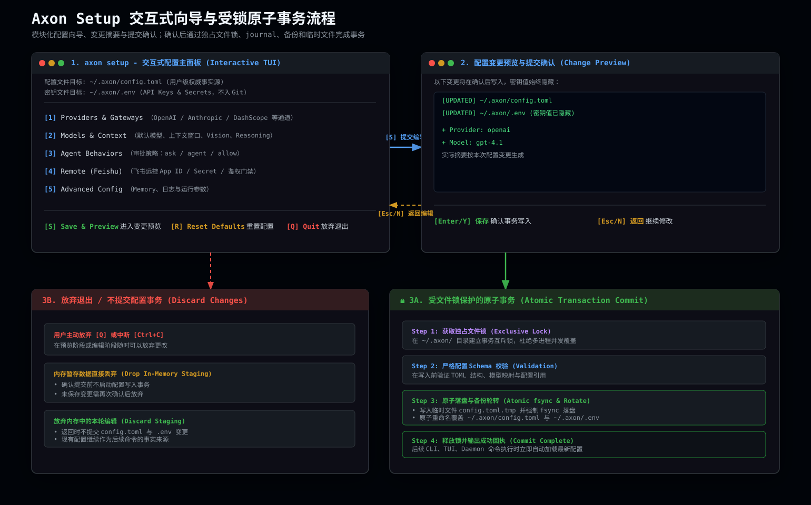

# 配置指南

`axon setup` 通过交互式向导收集配置，并在确认后以受锁事务写入本机配置文件。



本章介绍 Axon 的配置系统，覆盖 Provider、模型、环境变量、MCP、Skills、远控与 Memory 等配置项。

完整配置示例见仓库根目录的 [`config.example.toml`](../config.example.toml)、[`.env.example`](../.env.example)、[`mcp_stdio.example.json`](../mcp_stdio.example.json) 与 [`mcp_streamable_http.example.json`](../mcp_streamable_http.example.json)。

## 配置文件结构

Axon 使用以下用户级目录布局：

```text
~/.axon/
├── config.toml          # 用户级配置
├── SOUL.md              # 主代理的用户级角色与表达风格
├── AGENTS.md            # 跨工作地点生效的用户级规则
├── skills/              # 用户级 Skill
├── .mcp.json            # 用户级 MCP server 配置
├── .env                 # API Key 与 Secrets（不提交到 Git）
├── cache/               # 用户级缓存
├── data/                # Memory 与运行时数据
└── sessions/            # 用户级会话历史

.axon/                   # 项目级资产（可选）
└── config.toml          # 仅在显式 --config 时作为配置入口
```

`cache/`、`data/`、`sessions/` 等运行态数据默认始终写入用户级 `~/.axon/`，避免污染项目工作区。

## 配置项参考

以下字段均来自当前配置 schema；配置结构使用 TOML 的表（`[section]`）和数组表（`[[providers]]`、`[[models]]`）。

### Agent 与运行策略

| 配置项 | 类型 | 可选值/范围 | 默认值 |
| --- | --- | --- | --- |
| `agent.default_model` | 字符串 | 已配置模型的 `name` 或 `id`；有模型时不能为空 | `""` |
| `agent.fast_model` | 字符串 | 已配置模型的 `name` 或 `id`；有模型时不能为空 | `""` |
| `agent.reasoning_effort` | 字符串 | `none`、`minimal`、`low`、`medium`、`high`、`xhigh`、`max` | `"medium"` |
| `agent.max_subagent_threads` | 无符号整数 | `>= 1` | `16` |
| `agent.max_subagent_active_turns` | 无符号整数 | `>= 1` | `16` |
| `agent.max_subagent_depth` | 无符号整数 | `>= 1` | `3` |
| `agent.auto_compaction_threshold` | 浮点数 | `0.0..=1.0` | `0.8` |
| `agent.idle_compaction_debounce_ms` | 无符号整数 | `>= 1`，单位毫秒 | `2000` |
| `agent.log_level` | 字符串 | `trace`、`debug`、`info`、`warn`、`error` | `"warn"` |

`[tui]` 当前为空配置段；视觉 MIME 与本地确认开关属于内部固定策略，不接受用户配置。

### Provider 目录

每个 `[[providers]]` 必须使用唯一的 `name`。`api_key` 与 `api_key_env` 二选一即可，直接配置的 `api_key` 优先级更高，生产环境建议只使用环境变量。

| 配置项 | 类型 | 可选值/范围 | 默认值 |
| --- | --- | --- | --- |
| `providers[].name` | 字符串 | 非空且全局唯一 | `""` |
| `providers[].enabled` | 布尔值 | `true`、`false` | `true` |
| `providers[].protocol` | 字符串 | `openai`、`openai-chatcompletions`、`anthropic`、`dashscope`、`volcengine-ark-multimodal` | `"openai"` |
| `providers[].base_url` | 字符串 | `http://` 或 `https://` URL | `""`；setup 会按协议推导 |
| `providers[].api_key_env` | 字符串 | 环境变量名或省略 | 无 |
| `providers[].api_key` | 字符串 | 非空密钥或省略 | 无 |
| `providers[].wire_transport` | 字符串 | `http`、`websocket` | `"http"` |
| `providers[].websocket_url` | 字符串 | `ws`、`wss`、`http`、`https` URL 或省略 | 省略；由 `base_url` 推导 |
| `providers[].enable_request_compression` | 布尔值 | `true`、`false` | `false` |
| `providers[].priority` | 32 位整数 | 数值越大越优先 | `0` |

`base_url` 的协议推导默认值为：`openai`/`openai-chatcompletions` 使用 `https://api.openai.com/v1`，`anthropic` 使用 `https://api.anthropic.com/v1`，`dashscope` 使用 `https://dashscope.aliyuncs.com/api/v1`，`volcengine-ark-multimodal` 使用 `https://ark.cn-beijing.volces.com/api/v3`。

### 模型目录

| 配置项 | 类型 | 可选值/范围 | 默认值 |
| --- | --- | --- | --- |
| `models[].name` | 字符串 | 任意字符串；为空时按 `id` 路由 | `""` |
| `models[].id` | 字符串 | 非空字符串 | `""` |
| `models[].provider` | 字符串 | 已配置 Provider 的 `name` | `""` |
| `models[].context_window` | 无符号整数 | 非 embedding 模型必须 `> 0`；embedding 模型可为 `0` | `128000` |
| `models[].max_output_tokens` | 无符号整数 | `> 0` 或省略 | `128000` |
| `models[].supports_vision` | 布尔值 | `true`、`false` | `true` |
| `models[].supports_embedding` | 布尔值 | `true`、`false` | `false` |
| `models[].embedding_dimension` | 无符号整数 | embedding 模型必须 `> 0`，其他模型必须为 `0` | `0` |
| `models[].requires_reasoning_content_on_assistant_messages` | 布尔值 | `true`、`false` | `false` |

`supports_embedding = true` 的模型只能使用支持 embedding 的 Provider 协议（`openai`、`openai-chatcompletions`、`dashscope` 或 `volcengine-ark-multimodal`）。

### 渠道负载均衡

| 配置项 | 类型 | 可选值/范围 | 默认值 |
| --- | --- | --- | --- |
| `channel_balancer.failure_threshold` | 无符号整数 | `>= 1` | `3` |
| `channel_balancer.cooldown_ms` | 无符号整数 | `>= 1`，单位毫秒 | `30000` |
| `channel_balancer.affinity_ttl_ms` | 无符号整数 | `>= 1`，单位毫秒 | `300000` |
| `channel_balancer.telemetry_persistence_enabled` | 布尔值 | `true`、`false` | `false` |

### 远控与 Feishu

| 配置项 | 类型 | 可选值/范围 | 默认值 |
| --- | --- | --- | --- |
| `remote.mode` | 字符串 | `standard`、`high-throughput` | `"standard"` |
| `remote.gateway.api_token_env` | 字符串 | 仅含字母、数字、下划线的非空名称 | `"AXON_GATEWAY_API_TOKEN"` |
| `remote.gateway.http_bind` | 字符串 | 有效的 IP:端口地址 | `"127.0.0.1:3143"` |
| `remote.gateway.websocket_bind` | 字符串 | 有效的 IP:端口地址 | `"127.0.0.1:3144"` |
| `remote.feishu_websocket.enabled` | 布尔值 | `true`、`false` | `false` |
| `remote.feishu_websocket.app_id` | 字符串 | 飞书应用 ID | `""` |
| `remote.feishu_websocket.app_secret_env` | 字符串 | 环境变量名 | `""` |
| `remote.feishu_websocket.api_base_url` | 字符串 | `http` 或 `https` URL；空值使用官方默认地址 | `""` |
| `remote.feishu_websocket.websocket_url` | 字符串 | WebSocket URL；空值使用官方默认地址 | `""` |
| `remote.feishu_websocket.enable_notification_sending` | 布尔值 | `true`、`false` | `false` |
| `remote.feishu_websocket.notification_chat_id` | 字符串 | 用户级全局通知会话 `chat_id`，经 `GET /api/v1/crons/config` 的 `defaultNotificationChatId` 暴露；用户未指明目标时由 Agent 作为默认 `wake` 采用，后端不做隐式兜底 | `""` |
| `remote.feishu_websocket.allowed_sender_open_ids` | 字符串数组 | sender `open_id` 列表 | `[]` |
| `remote.feishu_websocket.blocked_sender_open_ids` | 字符串数组 | sender `open_id` 列表；优先级高于 allowlist | `[]` |
| `remote.feishu_websocket.require_mention` | 布尔值 | `true`、`false` | `false` |
| `remote.feishu_websocket.chat_policies[].chat_id` | 字符串 | 非空 Feishu `chat_id` | 无 |
| `remote.feishu_websocket.chat_policies[].allowed_sender_open_ids` | 字符串数组 | sender `open_id` 列表 | `[]` |
| `remote.feishu_websocket.chat_policies[].blocked_sender_open_ids` | 字符串数组 | sender `open_id` 列表 | `[]` |
| `remote.feishu_websocket.chat_policies[].require_mention` | 可选布尔值 | `true`、`false` 或省略（继承全局值） | 省略 |

`remote.mode` 只改变运行时内部的 cursor 与 payload 预算，不再单独配置事件数或字节上限。Gateway 默认仅监听本机地址；对外提供服务时应配合防火墙或反向代理。

### 图像、Memory 与 Skills

| 配置项 | 类型 | 可选值/范围 | 默认值 |
| --- | --- | --- | --- |
| `memory.embedding.enabled` | 布尔值 | `true`、`false` | `false` |
| `memory.embedding.model` | 字符串 | `supports_embedding = true` 模型的 `name` 或 `id`；启用时不能为空 | `""` |
| `skills.disabled` | 字符串数组 | 任意 Skill name | `[]` |

完整可复制模板见仓库根目录的 [`config.example.toml`](../config.example.toml)。配置加载忽略未声明字段：拼写错误或已移除的键不会阻断加载，但不会生效，并在下次保存时被丢弃。

### 子进程资源围栏

Axon 为 shell 工具启动的子进程设置 OS 级资源上限：Unix 用 `setrlimit`，Windows 用 Job Object。围栏是**内核硬边界**，不依赖静态命令黑名单；即使工具可直接执行，失控命令仍会被内核拒绝或终止。

| 环境变量 | 维度 | 默认值 | 单位 |
| --- | --- | --- | --- |
| `AXON_PROCESS_RLIMIT_FSIZE_BYTES` | 单个文件大小（Unix `RLIMIT_FSIZE`） | `4294967296` | 字节 |
| `AXON_PROCESS_RLIMIT_NPROC` | 进程数（Unix `RLIMIT_NPROC` / Windows `ACTIVE_PROCESS`） | `4096` | 个 |
| `AXON_PROCESS_RLIMIT_NOFILE` | 打开文件描述符（Unix `RLIMIT_NOFILE`） | `4096` | 个 |
| `AXON_PROCESS_RLIMIT_AS_BYTES` | 地址空间（Unix `RLIMIT_AS` / Windows `PROCESS_MEMORY`） | 不限制 | 字节 |

每个维度独立覆盖，取值为 `off` 或 `0` 时该维度不限制；非法取值回落到默认值而不是静默取消围栏。变量必须在启动 Axon 的 shell 中设置（`~/.axon/.env` 只用于 provider 凭据，其中的围栏变量不会被读取）：

```bash
# 临时关闭全部围栏，用于排查围栏本身导致的故障
AXON_PROCESS_RLIMIT_FSIZE_BYTES=off \
AXON_PROCESS_RLIMIT_NPROC=off \
AXON_PROCESS_RLIMIT_NOFILE=off \
axon run "…"
```

默认值的选取原则是「宽到不影响正常构建，紧到能阻断失控写入与进程爆炸」：`RLIMIT_FSIZE` 远高于单次构建产物量级；`RLIMIT_AS` 默认不限制，因为 rustc/LLVM 在个别 crate 上会用到数 GiB 地址空间，设限会误伤正常构建。PTY 交互式会话（`tty: true`）使用单独一组更宽的限额（`FSIZE` 8 GiB、`NPROC` 16384、`NOFILE` 8192），因为它会自建并行作业编排。

平台差异：

| 维度 | Unix | Windows |
| --- | --- | --- |
| 文件大小 | `RLIMIT_FSIZE`，超限进程被 `SIGXFSZ` 终止 | 无等价物，只能依赖 artifact 上限与静态分析 |
| 进程数 | `RLIMIT_NPROC`（对 root 不生效） | `JOB_OBJECT_LIMIT_ACTIVE_PROCESS` |
| 打开文件数 | `RLIMIT_NOFILE` | 无等价物 |
| 地址空间 | `RLIMIT_AS` | `JOB_OBJECT_LIMIT_PROCESS_MEMORY` |

Windows 侧的 PTY（ConPTY）会话不做围栏：`portable_pty` 不返回子进程句柄，无法绑定 Job Object。此外 Windows 的 Job Object 绑定发生在进程启动之后，子进程在该窗口内派生的孙进程不受限额约束。

`setrlimit` 只能**降低**硬限制，因此当容器或宿主已经给了更低的硬限制时，Axon 静默取两者的较小值而不是报错。

### Soul

产品安装器会在 `~/.axon/SOUL.md` 不存在时从发行包的单一默认模板创建该文件。重复安装与升级只补齐缺失文件，不覆盖用户已经编辑的内容；程序本体统一安装在 `~/.axon/bin`（Windows 为 `%USERPROFILE%\\.axon\\bin`），配置与运行数据不由安装包接管。

主代理在每次模型请求前重新读取 `SOUL.md`，因此保存后的内容从下一次请求开始生效，无需重启会话。子代理不加载 Soul。文件不存在或内容为空时直接跳过，不影响请求执行。

`SOUL.md` 使用 `axon-soul/v1` 结构化格式（必填 YAML frontmatter 加可选正文），字段与校验规则见 [人格系统](./persona.md)。不符合该格式的文件不会被装配，回合继续并留下带字段路径的告警；可用 `axon persona validate` 就地校验。

Soul 以独立、可缓存的 session-stable user context 发送，不写入基础 system prompt。修改 Soul 只会更新该 session-stable 段的缓存标识，基础 system prefix 及其缓存命名空间保持稳定。轮后的人格状态写入独立库 `~/.axon/data/persona/persona.sqlite3`，不改变该缓存段。

## 面向新用户的最小设置

大多数人只需要在 `axon setup` 中完成下面几项；协议、传输方式、上下文窗口、模型能力和路由权重由 Axon 根据供应商目录自动决定，不需要手工填写。

| 设置 | 作用 | 不设置时 |
| --- | --- | --- |
| 默认模型 | 决定 Personal Agent 的默认执行模型 | 使用配置中的第一个可用模型 |
| 模型密钥 | 让 Axon 能调用该模型 | 启动时提示缺少密钥 |
| 网络搜索密钥（可选） | 允许 Axon 查最新网页资料 | 不影响普通对话，只是不启用搜索 |

密钥只保存为环境变量引用或写入相邻 `.env`，不会出现在对话或常规状态报告中。首次运行 setup 自动生成的 Gateway API token 例外：仅在本次保存完成页明文展示，JSON 输出不会包含 token，后续重复运行不会轮换已有 token。只有确实需要更换供应商、模型或密钥时，才需要再次运行 setup。

### 配置加载顺序

未传全局参数 `--config` 时，所有 CLI 入口统一读取用户级 `~/.axon/config.toml`；当前目录中的 `.axon/config.toml` 不会隐式遮蔽用户配置。需要使用项目配置或测试配置时，必须显式传入 `--config <path>`。`--model`、`--reasoning-effort` 等命令参数只覆盖本轮对应值，其余未传参数继续使用所选配置文件中的默认值。

### 手工修改后的生效方式

`config.toml` 和相邻 `.env` 是本机配置事实来源。手工编辑后，后续 Axon 命令会重新读取并验证配置；修改失败时不会覆盖已经写入的文件。

## Provider 配置

Axon 支持 OpenAI-compatible、Anthropic、OpenRouter、本地模型（如 Ollama）以及多模型聚合平台。`enabled` 可省略，默认值为 `true`；设为 `false` 后，该 Provider 及其关联模型不会进入 CLI、TUI、图像生成或 Memory embedding 的运行时模型路由与模型目录。禁用只暂停使用，不删除 Provider、模型或密钥配置。

Provider 的 prompt cache、显式 cache breakpoint 和服务端会话状态能力由运行时根据 `protocol` 统一推导，不属于 `config.toml` 配置契约。用户配置中出现 `[providers.capabilities]` 或对应的 `supports_*` 字段属于未声明字段，会被忽略，不会改变运行时能力推导。

### OpenAI

```toml
[[providers]]
name = "openai"
enabled = true
protocol = "openai"
base_url = "https://api.openai.com/v1"
api_key_env = "OPENAI_API_KEY"

[[models]]
name = "gpt-4o"
id = "gpt-4o"
provider = "openai"
context_window = 128000
supports_vision = true
```

### Anthropic

```toml
[[providers]]
name = "anthropic"
enabled = true
protocol = "anthropic"
base_url = "https://api.anthropic.com/v1"
api_key_env = "ANTHROPIC_API_KEY"

[[models]]
name = "claude-sonnet-4-5"
id = "claude-sonnet-4-5"
provider = "anthropic"
context_window = 200000
supports_vision = true
```

### Structured Outputs 能力

普通 coding turn 的可选结构化输出契约（`structured_output`）由 wire adapter 映射为 OpenAI Responses `text.format`、OpenAI-compatible Chat Completions `response_format` 或 Anthropic Messages `output_config.format`。这不是独立 Provider 配置项，也不会创建另一条请求链。

具体模型和上游渠道必须实际支持对应协议的原生 Structured Outputs。Anthropic 官方支持范围从 Claude 4.5 及后续指定模型开始；OpenAI-compatible 聚合渠道即使接受普通 Chat/Responses，也可能拒绝 `response_format`。需要原生结构化输出的模型没有可用渠道时，请启用支持该能力的 Provider；`enabled=false` 的 Provider 不会作为隐式 fallback。

Provider 拒绝原生 `json_schema` 时，Axon 默认降级为 `PromptOnly`：把 JSON Schema 契约并入 system prompt 后按普通文本请求重试一次，不再发送任何原生结构化输出字段，并按 provider/协议/模型缓存降级结果，避免重复触发同样的拒绝。降级只改变格式约束的承载方式，返回内容仍由调用方按同一 schema 独立校验；能力错误本身会保留 provider、HTTP 状态、request id 与结构化错误。

### OpenRouter

```toml
[[providers]]
name = "openrouter"
protocol = "openai"
base_url = "https://openrouter.ai/api/v1"
api_key_env = "OPENROUTER_API_KEY"

[[models]]
name = "openrouter-auto"
id = "openrouter/auto"
provider = "openrouter"
context_window = 128000
supports_vision = false
```

### 本地模型（Ollama）

```toml
[[providers]]
name = "ollama"
protocol = "openai"
base_url = "http://localhost:11434/v1"
api_key_env = "OLLAMA_API_KEY"

[[models]]
name = "llama3.1-70b"
id = "llama3.1:70b"
provider = "ollama"
context_window = 128000
supports_vision = false
```

### DashScope 与火山方舟

DashScope 与火山方舟多模态接入分别使用 `protocol = "dashscope"` 与 `protocol = "volcengine-ark-multimodal"`。传输方式默认 HTTP；明确支持 WebSocket 的 Provider 可在配置中显式指定。

Provider streaming 的 WebSocket 当前只适用于 OpenAI Responses（`protocol = "openai-responses"`）。OpenAI-compatible Chat Completions 与 Anthropic Messages 即使配置了 WebSocket，也会自动降级为 HTTP；普通请求、自动压缩和手动 `/compact` 均遵循同一协议请求构造、缓存形状和状态清理闭环，不会发送不兼容的 Responses `previous_response_id`。

## 模型配置

`[[models]]` 只描述模型如何连接 provider，以及模型是否支持视觉或 embedding；不要在 `[[models]]` 内配置 `tier`、`reasoning_effort`、`service_tier`、`reasoning_summary` 或 `supports_tools`。

`max_output_tokens` 可省略，默认值为 `128000`；需要覆盖模型输出能力时可显式配置大于 `0` 的值。

### 自动上下文压缩

`[agent].auto_compaction_threshold` 是 `0.0..=1.0` 的比例，默认值为 `0.8`。自动压缩阈值固定按当前模型的 `context_window × auto_compaction_threshold` 计算；Provider 请求不再额外建立独立的 `output_token_reserve` 发送门禁，避免出现两套口径。

自动压缩只依据 Provider 上报的当前请求上下文 usage：OpenAI Responses、Chat Completions 与 Anthropic Messages 均使用归一化后的 `current_context_tokens`。统计层的完整输入统一为 `total_input_tokens`，缓存命中率按 `cache_read_input_tokens / total_input_tokens` 计算。Provider 未返回有效 usage 时不触发自动压缩，不使用历史字符数或本地 token 估算兜底。

自动压缩和 idle 压缩在触发判断时选定的 `ChannelBalancedModel` 会贯穿整个压缩请求，阈值、摘要 Provider、输出上限和 replacement history 使用同一模型与渠道；渠道健康状态或亲和缓存变化不会在 debounce/摘要阶段悄然改写上下文窗口语义。手动 `/compact` 仍按调用时重新选择可用渠道。

压缩替换历史时遵循 Codex 的保留顺序：保留稳定的 system/developer 与 session-stable 上下文，保留最近真实用户消息和压缩 checkpoint；动态工作区 Context 不会重新插入稳定缓存前缀，避免无关状态变化扩大 Prompt Cache 失配范围。压缩生命周期会展示 `0%`、`50%`、`100%` 阶段，完成摘要中的 token 数使用 Axon 统一单位格式。摘要和 checkpoint 输出统一限制为模型 `context_window / 8`，并取配置 `max_output_tokens` 的较小值。

压缩 replacement history 会先做 Provider 工具历史归一化，再按工具单元分配尾部预算。已结算的 assistant tool call 与对应 tool result 必须整组保留或整组淘汰；活动 tool call 会连同稳定的中止回执保留，并继续由 canonical checkpoint 记录其调用 ID。提交前会拒绝重复 call、孤立 result 或未配对 call，避免把结构损坏的投影发布给 Provider。

摘要请求或完整性门禁失败时，Axon 会记录当前模型可见历史的指纹。同一视图不重复发起压缩；Provider 产生新消息、工具回执或其他历史变化后，下一安全 turn 才恢复尝试，避免持续产生相同失败事件。

Context Compaction timeline 使用独立锁文件串行化跨线程和跨进程 JSONL 追加，单次写入完整记录；读取时允许丢弃进程中断留下的末尾半行，不会因单条尾部损坏而丢失此前的压缩审计记录。timeline 持久化失败会向上传播，避免装配器静默报告成功。

### 思考强度

`agent.reasoning_effort` 可配置 `none`、`minimal`、`low`、`medium`、`high`、`xhigh`、`max`：

- OpenAI 协议接受 `none` 至 `max`。
- Anthropic 协议接受 `low` 至 `max`。
- 切换到能力集合更窄的协议时，协议外的合法档位会静默省略。
- 具体模型可能只支持协议集合的一部分；模型明确返回 effort 不支持时，Axon 会按该协议由高到低重试并缓存当前进程内的可用档位。

### 视觉与 Embedding

```toml
[[models]]
name = "text-embedding-3-large"
id = "text-embedding-3-large"
provider = "openai"
context_window = 8192
supports_vision = false
supports_embedding = true
embedding_dimension = 3072
```

### 模型切换

临时切换：

```bash
axon run --model gpt-4o-mini "任务"
```

持久切换：

```bash
axon setup --non-interactive --model claude-sonnet-4-5
```

重置与清除配置：

```bash
# 重置 Provider 及其所属模型
axon setup --non-interactive --reset-provider openai

# 重置 Agent 模型槽与推理强度
axon setup --non-interactive --reset-agent-models

# 清除指定字段
axon setup --non-interactive --clear-websocket-url --clear-api-key
```

## 工具执行策略

工具执行不需要配置审批策略，也不会等待 TUI、非交互 CLI、远端控制或 Guardian 的人工确认。每次调用只产生 `Allowed` 或 `Forbidden`：`Allowed` 直接进入执行链，`Forbidden` 拒绝执行并保留结构化原因。

## 环境变量

完整变量列表见 [`.env.example`](../.env.example)。常用变量：

| 变量 | 用途 |
|------|------|
| `OPENAI_API_KEY` | OpenAI |
| `ANTHROPIC_API_KEY` | Anthropic |
| `OPENROUTER_API_KEY` | OpenRouter |
| `FEISHU_APP_ID` / `FEISHU_APP_SECRET` | 飞书远控 |
| `AXON_LOG_LEVEL` | 日志级别：`trace` / `debug` / `info` / `warn` / `error`（`trace` 等价 `debug`），优先于 `[agent].log_level` |
| `AXON_LOG_FILE` | 日志输出文件路径；设置后固定写该文件，不再按日期滚动，留空则滚动写入 `<root>/data/logs/axon-<日期>.log` |
| `HTTP_PROXY` / `HTTPS_PROXY` / `NO_PROXY` | 代理配置 |
| `AXON_CONTEXT_COMPRESSION_THRESHOLD` | 上下文自动压缩阈值（0.0–1.0） |
| `AXON_SESSION_AUTOSAVE_INTERVAL` | 会话自动保存间隔（秒） |
| `AXON_PROCESS_RLIMIT_FSIZE_BYTES` | 子进程单文件大小上限（字节），`off` 或 `0` 表示不限制 |
| `AXON_PROCESS_RLIMIT_NPROC` | 子进程数上限，`off` 或 `0` 表示不限制 |
| `AXON_PROCESS_RLIMIT_NOFILE` | 子进程打开文件数上限，`off` 或 `0` 表示不限制 |
| `AXON_PROCESS_RLIMIT_AS_BYTES` | 子进程地址空间上限（字节），默认不限制 |

首字链路性能遥测仅在 `config.toml` 的 `[agent].log_level = "trace"` 时启用。`AXON_LOG_LEVEL=trace` 仍可临时提高日志详细度，但不会开启遥测；修改配置后需重启当前 CLI 或 Daemon 进程。

## MCP 服务器配置

MCP server 只从用户级与当前 Workspace 配置加载：

```text
~/.axon/.mcp.json
<workspace>/.mcp.json
```

### stdio

```json
{
  "mcpServers": {
    "filesystem": {
      "type": "stdio",
      "command": "npx",
      "args": ["-y", "@modelcontextprotocol/server-filesystem", "/path/to/workspace"],
      "cwd": "/path/to/workspace"
    }
  }
}
```

### Streamable HTTP

```json
{
  "mcpServers": {
    "remote": {
      "type": "streamable_http",
      "url": "https://mcp.example.com/mcp",
      "bearerTokenEnvVar": "MCP_TOKEN",
      "headers": {}
    }
  }
}
```

`bearerTokenEnvVar` 只保存环境变量名，运行时读取变量值并生成 `Authorization: Bearer <token>`；配置、CLI JSON 输出和资源投影都不会输出 token 原文。

端点返回 401，或返回 403 且声明 `error="insufficient_scope"` 时，Axon 按 MCP `2026-07-28` 授权规范进入 OAuth 闭环：CLI 与 TUI `/mcp` 会给出 `axon mcp login <server>` / `/mcp login <server>` 引导，凭据与动态注册结果保存在 `~/.axon/mcp-oauth/`。完整流程（元数据发现、客户端注册优先级、scope 选择、issuer 校验）见 [MCP 集成](./mcp.md)。

server 名会规范化为小写下划线形式的稳定 `server_id`。User 配置优先于 Workspace 配置；User 已提供同名或规范化后同 ID 的 server 时，不再加载 Workspace 项。详细说明见 [MCP 集成](./mcp.md)。

## Skills 配置

Skills 搜索路径（按优先级）：

1. `~/.axon/skills/` — 用户级 Axon Skills
2. `<workspace>/.axon/skills/` — Workspace 级 Axon Skills

每个根目录只扫描直接子目录中的 `SKILL.md`。User Skill 优先于 Workspace Skill，同名项只加载 User 版本。仓库中的 `docs/skills/` 不参与运行时扫描。frontmatter 至少需要字符串 `name` 与 `description`；额外字段可用于兼容其他 Skill 生态，但 Axon 不把它们解释为权限、依赖或执行配置。详细说明见 [Skills](./skills.md)。

## 显式项目配置

项目需要独立配置时，可在项目根目录创建 `.axon/config.toml`，并在命令中显式指定：

```bash
axon --config ./.axon/config.toml run "分析当前项目"
```

显式配置文件必须是完整、可独立校验的 Axon TOML 配置，不会与用户配置隐式合并，避免仓库文件意外遮蔽用户配置。

## 飞书远程控制

飞书远控使用事件订阅 WebSocket 长连接模式。配置文件只保存 App 标识、凭证环境变量名、访问治理与群聊策略：

```toml
[remote]
mode = "standard"

[remote.gateway]
api_token_env = "AXON_GATEWAY_API_TOKEN"
http_bind = "127.0.0.1:3143"
websocket_bind = "127.0.0.1:3144"

# 需要局域网/外部网络访问时，可分别改为 0.0.0.0:3143、0.0.0.0:3144
# 或 IPv6 的 [::]:3143、[::]:3144；公网暴露前必须配置防火墙或反向代理。

[remote.feishu_websocket]
enabled = true
app_id = "cli_xxx"
app_secret_env = "FEISHU_APP_SECRET"
enable_notification_sending = true
# 后台 Goal/Cron 完成通知只发送到这个明确会话；留空则不发送
notification_chat_id = "oc_notify"
allowed_sender_open_ids = ["ou_allowed"]
blocked_sender_open_ids = ["ou_blocked"]
require_mention = true

[[remote.feishu_websocket.chat_policies]]
chat_id = "oc_ops"
allowed_sender_open_ids = ["ou_ops"]
blocked_sender_open_ids = []
require_mention = true
```

`remote.mode` 是远控吞吐治理的用户入口：

| 模式 | 适用场景 |
|------|----------|
| `standard` | 常规飞书远控、低频协作 |
| `high-throughput` | 高频事件流、密集群聊协作 |

完整命令与状态机见 [CLI 参考](./cli.md) 的 daemon 与 cron 部分。

## Memory

Memory 的持久化位置、SQLite busy timeout、索引算法参数和内部 SQL 批次由运行时管理，不暴露线程扫描数、固定候选数、最大 diff 字节数、治理扫描容量或作业总 timeout 等伪配置。自动召回数量由当前模型的 `context_window` 与统一 Context Budget 决定；CLI 的 `--limit` 只表示用户显式请求的展示或操作范围，不受 Axon 内建最大值限制。

Retention policy 不会自动生成 TTL。需要按绝对时间过期的记录必须在写入时显式提供 `ttl_expires_at_ms`；默认治理继续保留 30 天半衰期的低活跃衰减归档。

## 配置验证

```bash
# 默认只读诊断：配置、Provider、IPC、服务和数据完整性
axon doctor

# 需要自动修复时显式开启
axon doctor --fix
```

## 下一步

- [Provider 与模型](./providers.md) — Provider 管理与连通性探测命令。
- [MCP 集成](./mcp.md) — MCP 协议与外部 server 集成。
- [Skills](./skills.md) — 可复用工作流。
