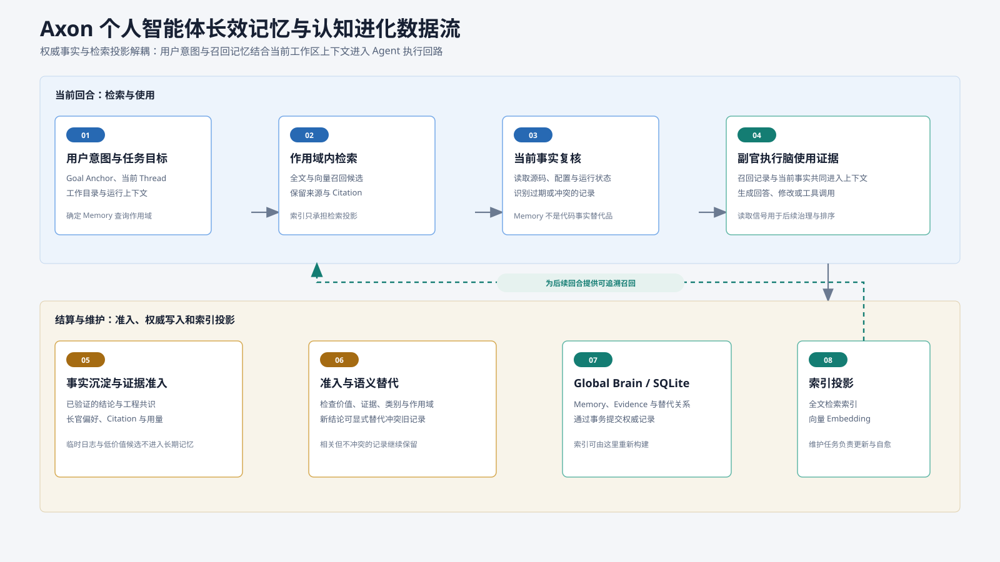

# 记忆管理系统 (Memory Management)

Axon 的记忆管理系统是构建长周期个人智能体（Personal Agent）的核心认知底座。通过分层持久化、因果图谱演进与检索投影读写分离机制，Axon 解决了大语言模型固有的无状态性与上下文窗口约束，实现“越用越懂你、越协作越精准”的渐进式认知深化。

---

## 1. 核心设计哲学

Axon 记忆系统遵循以下四大核心架构原则：

1. **SQLite 唯一权威事实源 (Single Source of Truth, SSOT)**  
   关系型数据库（SQLite）是记忆状态、元数据与因果演化关系的唯一事实标准。所有写操作必须先在 SQLite 中原子性提交成功，才被认定为持久化完成。
2. **检索投影与读写分离 (Projections & CQRS)**  
   BM25 文本全文检索（Tantivy）与高维向量嵌入检索（HNSW）被定义为**只读派生投影**，而非事实源。检索投影与权威存储解耦，可随时基于 SQLite 全量或增量重建；即使检索索引损坏，也不会导致用户记忆丢失。
3. **双层空间与严格安全隔离 (Dual-Scope Isolation)**  
   将认知空间严格划分为跨工作区通用的个人全局记忆（Personal Scope）与代码库绑定的工作区记忆（Workspace Scope），从领域模型根部杜绝跨项目与跨用户的认知污染。
4. **因果演进与不可变版本图 (Supersession Graph)**  
   记忆更新不采用破坏性原地覆盖，而是通过生成新记录并指向前驱记录的 `supersedes` 机制，构建有向无环的认知演化版本链。

---

## 2. 记忆分类与作用域模型

Axon 将认知数据抽象为稳定的五大记忆类型（`MemoryKind`），并在作用域级别强制实施隔离规则。

```text
┌────────────────────────────────────────────────────────────────────────┐
│                              认知空间划分                                │
├───────────────────────────────────┬────────────────────────────────────┤
│   Personal Scope (全局个人记忆)    │   Workspace Scope (代码库工作区记忆) │
│   · 跨项目共享                     │   · 仅限特定工程上下文               │
│   · 绑定当前用户/所有者              │   · 绑定绝对路径与 Namespace         │
├───────────────────────────────────┼────────────────────────────────────┤
│   • profile   (个人身份与画像)    │   • experience (项目踩坑与排错经验) │
│   • preference (工作偏好与风格约束) │   • knowledge  (架构决策与业务模型) │
│                                   │   • procedure  (标准作业规范与流程) │
└───────────────────────────────────┴────────────────────────────────────┘
```

### 2.1 记忆分类定义 (`MemoryKind`)

| 类型代码 (`memoryKind`) | 归属作用域 | 概念定位 | 典型应用场景 |
| :--- | :--- | :--- | :--- |
| `profile` | **Personal** | 个人画像与身份事实 | 用户角色、主要职责、常用技术栈、硬件环境等客观身份事实。 |
| `preference` | **Personal** | 行为偏好与沟通约束 | 输出语言偏好、代码缩进规范、审查严格度、极简沟通风格等。 |
| `experience` | **Workspace** | 踩坑教训与经验沉淀 | 特定框架依赖的已知缺陷避坑方案、构建失败处理方案、异常根因。 |
| `knowledge` | **Workspace** | 架构事实与领域知识 | 微服务划分、核心数据表设计、洋葱架构依赖约束、业务领域专有名词。 |
| `procedure` | **Workspace** | 操作流程与标准 SOP | 项目集成部署步骤、发布检查清单、数据库迁移与验证固定流程。 |

> **表达风格偏好的归属**：纯粹的说话风格与措辞偏好由人格系统承接（见 [人格系统](./persona.md)），不写入 Memory，避免同一条偏好存在两份事实源。Memory 的 `preference` 继续承接语言、规范、审查严格度这类可执行的行为约束。

### 2.2 作用域派生与安全约束

- **Personal 记忆**：自动绑定当前会话的 Owner。写入与修改请求中**严禁包含** `workspacePath`（传值将直接被拦截拒绝）。不同 Owner 之间的 Personal 记忆在任何查询与读取路径中均绝对不可见。
- **Workspace 记忆**：写入时必须显式提供文件夹绝对路径 `workspacePath`。服务端通过 `Workspace Registry` 实时派生出唯一的 `namespaceRef` 和 `repoRef`，确保与 Agent 运行时自动捕获的上下文严格落在同一存储桶。
- **作用域继承**：当更新或替代已有的 Workspace 记忆时，新记录自动继承被替代前驱的作用域配置，无需客户端重复提交路径。

---

## 3. 存储架构与检索投影

系统采用多层读写分离架构，将高可靠持久化与高性能多模态检索相结合：



```text
                 ┌──────────────────────────────────────┐
                 │   写入请求 (Agent / REST / CLI / UI)   │
                 └──────────────────┬───────────────────┘
                                    │ (Fail-Closed 校验)
                                    ▼
                 ┌──────────────────────────────────────┐
                 │      MemoryWriteTriggerRuntime       │
                 └──────────────────┬───────────────────┘
                                    │
                  ┌─────────────────┴─────────────────┐
                  │ (事务提交)                         │ (异步/同步构建)
                  ▼                                   ▼
     ┌────────────────────────┐         ┌───────────────────────────┐
     │   SQLite 权威事实库     │         │       只读检索投影层       │
     │   (schema v4)          │         │                           │
     │ · memory_records       │         │ · Tantivy (BM25 全文索引)  │
     │ · memory_supersessions │         │ · HNSW (稠密高维向量空间)   │
     │ · memory_pipeline_jobs │         └─────────────┬─────────────┘
     └────────────┬───────────┘                       │
                  │                                   │ (失败标记 needsRepair)
                  └─────────────────┬─────────────────┘
                                    │
                                    ▼
                 ┌──────────────────────────────────────┐
                 │      一致性诊断与自愈 (Consistency)    │
                 └──────────────────────────────────────┘
```

### 3.1 SQLite 权威存储模型

SQLite 存储采用高内聚的数据模型（Schema v4）：

1. **`memory_records` 主表**：存储完整记忆正文与核心元数据。
   - `memory_id`：全局唯一无符号 64 位整型（`u64`）。
   - `memory_kind`：`TEXT NOT NULL`，仅允许存储五个标准小写代码值。
   - `state`：状态机标识，支持 `active`（有效）与 `tombstone`（软遗忘）。
   - `namespace_ref`：工作区命名空间，Personal 记录为空或保留系统默认命名空间。
   - `updated_at_ms` / `created_at_ms`：毫秒级时间戳。
2. **复合索引设计**：
   - `idx_memory_records_kind_timeline`：在 `(memory_kind, updated_at_ms DESC, memory_id ASC)` 上建立，加速按类型的有界时间轴游标扫描。
   - `idx_memory_records_scope_kind_timeline`：在 `(namespace_ref, memory_kind, updated_at_ms DESC, memory_id ASC)` 上建立，加速特定工作区的多维过滤。
3. **`memory_supersessions` 演化表**：
   - 记录 `(source_memory_id, target_memory_id)` 的演化边，完整重现版本的衍生谱系。

### 3.2 检索投影与容灾机制

- **双模态检索**：
  - **BM25 全文检索 (Tantivy)**：针对 `summary` 与 `evidence` 文本进行分词与倒排索引构建，精准命中关键词、类名、错误码等精确符号。
  - **向量语义检索 (HNSW)**：调用嵌入模型将记忆语义投影至稠密向量空间，支持基于自然语言意图的模糊召回。
- **容灾与独立性**：
  - 写入流程中，若 Tantivy 写入失败或向量模型不可用，**SQLite 权威写入仍会正常提交**，同时在响应中标记 `needsRepair: true`。系统不会因检索索引瞬时抖动而丢失记忆写入。
  - 读路径（列表、详情、统计）直接点对点查询 SQLite，无需初始化或加载重量级的 Tantivy/HNSW 引擎，保障管理面板轻量极速。

---

### 3.3 查询嵌入与多模态召回

- 查询向量按配置的 embedding provider 协议分流：`dashscope`（带 `enable_fusion`）与 `volcengine-ark-multimodal` 走原生多模态接口并取融合向量；`openai-multimodal-embeddings` 走网关 OpenAI 兼容 `/v1/embeddings`。协议不支持多模态时记 warning 后按纯文本降级，召回不中断。
- 网关 `qwen3-vl-embedding` 一次请求返回多条向量：`index 0` 文本、`index 1` 图像，且不透传 `enable_fusion`。Axon 按 index 升序解析为文本路与图像路两条查询向量，不自行融合。
- 检索阶段文本向量与图像向量各走一路向量召回，命中同一条记忆时按更优（更小）名次与距离合并成一个候选，再与 BM25、治理权重重排。
- 图片来源与 `memory search --image` 共用同一套归一化：`https://` URL 与 `data:image` base64 原样透传，本地路径按扩展名编码成 data URL，单图上限 10 MiB。
- 自动召回取本轮附件里的第一张可读图片（多模态 embedding 只消费一张图）；附件缺失或读取失败只跳过该图，不影响本轮召回。
- 输出维度以 `model.embedding_dimension` 为准，网关协议通过请求体顶层 `dimensions` 传递（已验证生效）；实际维度与配置不一致时按响应校验失败降级，不写坏索引。

## 4. 记忆生命周期与治理

记忆的全生命周期遵循严谨的准入、更新、遗忘与销毁流转逻辑：

```text
     [写入准入] ────────► Active (有效) ────────► Tombstone (已遗忘) ──► Deleted (彻底清除)
                                │                        ▲
                                │ (Supersedes 替代)       │
                                └──► Superseded (前驱) ──┘
```

### 4.1 写入与准入 (Admission)
- **触发渠道**：Agent 自主调用内置工具 `builtin.memory_write`、用户在桌面工作台手动提交、或通过 REST API / CLI 批量导入。
- **防噪准入**：输入必须包含非空 `summary`（高信噪比结论）与 `evidence`（充分支撑事实或可复现证据）。未经证实的中间推断严禁写入。
- **原子批量导入**：支持单条对象、对象数组以及 `{"records": [...]}` 包装格式。采用 **Fail-Closed** 策略：整批数据在写入前进行原子预检，任一条目存在非法字段、未知类型或作用域不匹配，整批写入全量回滚。

### 4.2 版本因果演进 (Supersession)
- **演化原则**：当既有认知被修正或深化时，调用方传入 `supersedesMemoryIds`。
- **处理机制**：系统生成具有全新 ID 的新记录，将前驱记录移出活动候选集，并在 `memory_supersessions` 建立有向边。新记录在时间轴上展示，同时保留向下追溯前因后果的能力。

### 4.3 软遗忘机制 (Tombstone)
- 调用遗忘接口（`POST /api/v1/memory/{id}/forget`）不会物理删除数据，而是将其状态标记为 `tombstone`。
- 标记为遗忘的记录将立刻从 Tantivy 与 HNSW 检索投影中剔除，不再参与日常会话的上下文装配，但在审计日志与管理面板中保留可追溯标记。

### 4.3.1 可逆归档 (Archive)
- 归档（`POST /api/v1/memory/{id}/archive`）只写 `archived_at_ms`，正文保持不变：记录退出召回与活跃时间轴，但仍出现在「已归档」窗口里。
- 取消归档（`POST /api/v1/memory/{id}/unarchive`）清空 `archived_at_ms`，记录重新参与召回与时间轴；低活跃与冲突治理归档的记录同样可以这样恢复。
- 已被遗忘的记录正文与引用已清除，因此不能归档或取消归档，只能永久删除；接口以 `400` 明确拒绝，不静默恢复。

### 4.4 物理级销毁 (Hard Delete)
- 调用删除接口（`DELETE /api/v1/memory/{id}`）执行彻底的级联清理：
  1. 从 SQLite `memory_records` 及关联演化表中物理移除该记录。
  2. 级联清理 Tantivy 索引中对应的 Document。
  3. 级联剔除 HNSW 向量库中的对应节点及邻接边。

---

## 5. 动态评分与时间衰减模型

为避免历史久远、过时的记忆干扰当前决策，Axon 引入了基于半衰期的动态权重衰减机制：

### 5.1 基础评分与衰减公式

每条记忆维护基础置信度（`confidenceBasisPoints`，取值 `0 ~ 10000`，对应 `0.0% ~ 100.0%`）。动态有效权重按以下指数规律衰减：

$$S(t) = S_0 \times \left(\frac{1}{2}\right)^{\frac{\Delta t}{T_{half}}}$$

其中：
- $S_0$：初始置信度得分（`confidenceBasisPoints`）。
- $\Delta t = t_{now} - t_{lastActive}$：自最后一次活跃或命中以来的流逝时间。
- $T_{half}$：记忆半衰期常量（系统标准缺省为 30 天）。
- $S(t)$：当前时间轴上展示并参与排序的衰减后得分（`decayedScoreBasisPoints`）。

### 5.2 认知激活与强化
当一条记忆在会话中被再次命中、验证并引用时，系统自动刷新其 `lastActiveAtMs` 时间戳。衰减曲线随即被重置并以最新时间点重新起算，实现“高频认知历久弥新，边缘噪声自然淡化”。

---

## 6. 管理接口与交互协议

系统提供一致的多端访问契约，涵盖 RESTful API、CLI 工具链以及桌面图形工作台。

### 6.1 RESTful Gateway 接口规范

网关统一暴露在 `/api/v1/memory` 路由下：

| HTTP 方法与路径 | 功能描述 | 请求参数 / 请求体重点 |
| :--- | :--- | :--- |
| `GET /api/v1/memory` | 有界时间轴游标分页查询 | `memoryKind`（必填）、`scope`、`status`（`active` 缺省 / `archived` / `all`）、`limit`（最大 100）、`cursorUpdatedAtMs`、`cursorMemoryId` |
| `GET /api/v1/memory/stats` | 记忆全局/作用域聚合统计 | `scope`（可选，支持 `all`、`personal`、`workspace`、`workspace:<ns>`）、`status`（决定 `memoryKindCounts` 的口径，缺省 `active`） |
| `GET /api/v1/memory/scopes` | 动态获取真实存在的命名空间列表 | 返回当前 SQLite 中实际存在的有效作用域及统计分布；`scope` 值就是记录的 namespace 引用，可原样回传给 `GET /api/v1/memory` |
| `GET /api/v1/memory/{memoryId}` | 单条记忆详情查询 | 路径参数 `memoryId`（64 位安全字符串） |
| `POST /api/v1/memory` | 新建记忆（支持单条与批量） | 支持单对象、数组或 `{"records": [...]}`。Workspace 必填 `workspacePath` |
| `POST /api/v1/memory/{memoryId}` | 替代更新记忆 | 自动建立 `supersedesMemoryIds` 演化关联，继承作用域 |
| `POST /api/v1/memory/{memoryId}/archive` | 归档记忆 | 写 `archived_at_ms`，正文保留，可取消归档 |
| `POST /api/v1/memory/{memoryId}/unarchive` | 取消归档 | 清空 `archived_at_ms`；已遗忘记录返回 `400` |
| `POST /api/v1/memory/{memoryId}/forget`| 软遗忘指定记忆 | 写入 `tombstone`，同步清除检索投影 |
| `DELETE /api/v1/memory/{memoryId}` | 物理删除记忆 | 原子级联删除 SQLite 记录与 Tantivy/HNSW 检索投影 |

#### 作用域取值约定
- `scope` 只接受 `all`、`personal`、`workspace` 与 `workspace:<namespace>`；`workspace:<namespace>` 里的 `<namespace>` 必须与 `GET /api/v1/memory/scopes` 返回的 `namespaceRef` 一致，适配层只剥掉一层传输前缀，绝不重复拼接 `workspace:`。
- `~/.axon`（Axon 主目录）不是普通 Workspace，但它是 Workspace Memory 的合法地点：在 Home 里写入的经验、知识与流程固定落在 `workspace:axon-home`，管理页把它显示为「Axon 主目录」。

#### 核心契约约定：大数 ID 字符串化
由于 `memoryId` 是 64 位无符号整数（`u64`，上限约 $1.8 \times 10^{19}$），超出 JavaScript 浮点数安全整数范围（$2^{53} - 1$）。为防止前端在序列化传输中发生精度截断，**Gateway、Desktop IPC 与 CLI 的所有 JSON 通信中，`memoryId`、`cursorMemoryId` 以及 `supersedesMemoryIds` 均强制采用十进制字符串**。

### 6.2 命令行工具 (CLI)

Axon CLI 提供了完整的记忆运维与诊断指令集：

```bash
# 1. 查看当前可见记忆列表（支持按类型与作用域筛选）
axon memory list --kind knowledge --scope workspace

# 2. 查看单条记忆详情与因果链
axon memory inspect "1320314326904667369"

# 3. 导出记忆库数据为 JSON 格式
axon memory export --output ./backup-memory.json

# 4. 运行记忆库与检索投影一致性检查
axon memory consistency

# 5. 一键自愈并重构检索投影（清理孤儿投影并重构 HNSW 索引）
axon memory consistency --repair
```

### 6.3 桌面工作台交互 (Desktop Workbench)

Axon Desktop 内置了专属的“记忆管理”交互工作台：
- **3D 时间轮与时间轴 (Memory Wheel / Timeline)**：直观呈现认知时间序列。支持滚轮滚动、方向键导航、以及聚焦项权重/置信度读数。
- **类型环总览 (Kind Ring Stats)**：展示五大类别的实时记录数量与健康状态。
- **可访问性降级 (Reduced Motion)**：在系统检测到 `prefers-reduced-motion` 偏好时，无缝切换为极简平面静态列表，保持完全一致的键盘与阅读语义。
- **双模录入界面**：提供常规表单录入与面向高级用户的专业 JSON 代码批量录入（具备实时语法校验与 Fail-Closed 错误提示）。

---

## 7. 数据一致性、自愈与平滑迁移

### 7.1 投影一致性自愈机制 (Projection Reconciliation)
当遭遇宿主机异常断电、磁盘满或外部进程干扰时，SQLite 权威记录与 Tantivy/HNSW 检索投影可能出现不一致。Axon 提供了专门的自愈管线：
1. **孤儿检测 (Orphan Detection)**：
   - 精确识别已在 SQLite 中被删除，但仍残留在向量库（`orphanProjectionRecords`）或文本索引（`orphanTextDocuments`）中的孤立数据。
2. **原子修剪与重构 (Prune & Rebuild)**：
   - 自动移除孤儿投影记录与文本文档。
   - 基于 SQLite 中全量有效记录，一次性原子重构 HNSW 向量索引图，确保语义检索空间纯净。

### 7.2 历史数据无损归档迁移 (Zero-Data-Loss Migration)
在底层数据库升级（如从历史 schema 迁移至 schema v4）时，Axon 遵循严苛的零丢失原则：
- **绝不执行 `DROP TABLE`**：对于缺少 `memory_kind` 等核心列的历史旧表，系统自动将其安全重命名为 `memory_records_legacy_<毫秒时间戳>` 并归档保留。
- **状态显式透出**：归档表信息通过 `legacyRecordTables` 暴露在统计接口与桌面管理页中，提示管理员可随时进行审计取证或历史数据回溯导入。

---

## 8. 相关文档与参考

- [核心概念与分层上下文](./concepts.md)
- [内置工具契约与 Schema](./tool-schema.md)
- [系统全景概览与架构拓扑](./overview.md)
- [Axon Desktop 桌面工作台手册](./desktop.md)
