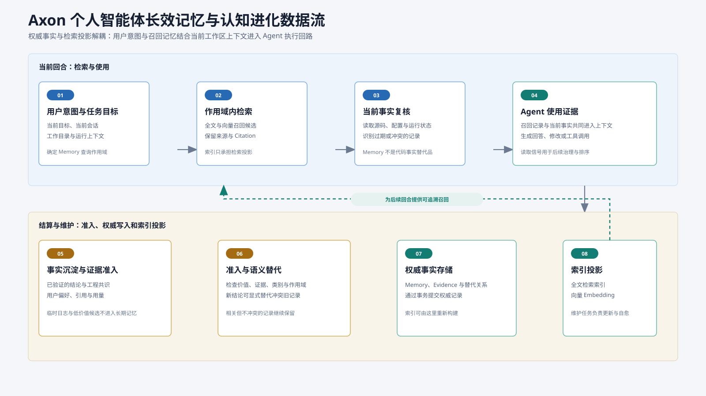

# 记忆管理系统

Axon 的记忆系统负责「越用越懂你」：把确认过的偏好、经验与架构事实留下来，在需要的那一轮按需带回上下文，而不是把整段历史重复塞进每次请求。

本页讲用户能感知的行为：记忆分几类、写进去要满足什么、怎么改、怎么忘、怎么查。实现细节不在产品文档范围内。



---

## 1. 四条用户可依赖的原则

1. **写进去就算数**：记忆写入是一次原子提交，写入成功即已持久化；中途失败整批回滚，不会留下半条记录。
2. **检索可以重建**：记忆的正文是权威数据，检索索引只是加速手段。索引损坏不会丢记忆，重建后原样恢复。
3. **作用域不串味**：个人记忆跨所有工作区共享，工作区记忆只对那个工程可见，互不覆盖。
4. **更新留痕**：修改认知不是覆盖旧记录，而是新增一条并标注它替代了谁，前因后果可以追溯。

---

## 2. 记忆分类与作用域

五类记忆，两个作用域：

| 类型（`memoryKind`） | 作用域 | 记什么 | 典型内容 |
| --- | --- | --- | --- |
| `profile` | 个人 | 身份与画像事实 | 角色、职责、常用技术栈、硬件环境 |
| `preference` | 个人 | 可执行的行为约束 | 输出语言、代码规范、审查严格度、沟通风格 |
| `experience` | 工作区 | 踩坑与经验 | 已知缺陷的规避办法、构建失败的处理方式 |
| `knowledge` | 工作区 | 架构与领域事实 | 模块划分、依赖约束、业务专有名词 |
| `procedure` | 工作区 | 流程与规范 | 集成部署步骤、发布检查清单 |

```text
个人作用域（Personal）                 工作区作用域（Workspace）
 ├── profile    身份事实                 ├── experience  踩坑经验
 └── preference 行为约束                 ├── knowledge   架构事实
                                         └── procedure   操作流程
```

**表达风格不属于记忆**：说话方式与措辞偏好由人格系统承接（见 [人格系统](./persona.md)），避免同一条偏好存在两份来源。

**作用域规则**

- 个人记忆自动绑定当前用户。写入时不要传工作区路径，传了会被直接拒绝；不同用户之间的个人记忆在读取路径上互不可见。
- 工作区记忆必须显式给出文件夹路径，系统据此归入对应工作区。
- 替代更新时，新记录自动继承被替代记录的作用域，不需要重复提交路径。

---

## 3. 写入准入

一条记忆要能被写入，必须同时具备两项：

- **`summary`**：一句话结论，要求高信噪比。
- **`evidence`**：支撑这条结论的证据，或可复现的步骤。

没有证据的中间推断不建议写入，这是记忆质量的第一道闸门。

**批量导入是整批生效的**：支持单条对象、对象数组与 `{"records": [...]}` 三种形态；写入前做一次整体预检，任一条目字段非法、类型未知或作用域不匹配，**整批回滚**，不会写一半。

---

## 4. 生命周期

```text
写入 ──► 有效（active） ──► 已遗忘（tombstone） ──► 彻底删除
              │   ▲
              │   └──── 归档（archived，可取消）
              ▼
          被替代（superseded，不再参与召回）
```

**替代更新**：认知被修正时传入它替代了哪些记录，系统生成新记录、把前驱移出召回候选，并保留从新到旧的追溯链。时间轴上看到的是最新版本，同时可以往下翻看前因后果。

**软遗忘**：调用遗忘接口不会删数据，而是标记为已遗忘。它立刻退出召回与检索，不再参与上下文装配，但在审计与管理面板里仍可见。

**归档可逆**：归档只记录归档时间，正文不变；记录退出召回与活跃时间轴，但仍出现在「已归档」窗口里，可随时取消归档。已经被遗忘的记录正文与引用都已清除，因此不能归档或取消归档，只能永久删除；接口会明确拒绝，而不是静默恢复。

**彻底删除**：物理删除会级联清理正文、演化关系与检索索引，不可恢复。

---

## 5. 会话线索与异常提示

**会话线索**是会话级上下文槽，不是话题实体：每条会话最多一条活跃线索，记录「这段对话在聊什么」，用来承接「这个」「它」「继续」这类指代。不同会话各自持有独立线索，互不读取也互不覆盖；定时任务只维护自己会话的线索，子代理不读写主对话的线索。

未闭合的承诺（例如「明天提醒我交周报」）属于用户级待办，不按会话隔离，换一个会话仍然看得见。

**异常提示**：每一轮装配前会做一次轻量检测，识别复读、文风突变与循环退化三类信号。命中时只在上下文尾部追加一段状态说明，让模型自己校正。它不是熔断：不截断内容、不改温度、不切模式、也不额外调用模型。

---

## 6. 时间衰减

历史越久的记忆权重越低，避免过时结论干扰当前判断：

- 每条记忆有一个基础置信度，展示与排序用的是按时间衰减后的分数。
- 半衰期默认 30 天：约每过 30 天权重减半。
- 一条记忆在会话里被再次命中并引用时，它的活跃时间被刷新，衰减从头起算。

效果是「常用的事实历久弥新，边缘噪声自然淡化」。

---

## 7. 管理入口

### 7.1 命令行

```bash
# 按类型与作用域列出记忆
axon memory list

# 检索记忆
axon memory search "发布流程"

# 查看单条记忆与追溯链
axon memory inspect <MEMORY_ID>

# 聚合统计
axon memory stats

# 导出与导入（JSON）
axon memory export --output <path>
axon memory import --input <path>

# 一致性与自愈
axon memory consistency
```

完整子命令以 `axon memory --help` 为准；同一批命令都有 `--format json` 输出，便于脚本消费。

### 7.2 网关接口

管理面挂在 `/api/v1/memory` 下，全部需要凭据：

| 方法 | 路径 | 作用 |
| --- | --- | --- |
| `GET` | `/api/v1/memory` | 按类型、作用域与状态分页读取时间轴 |
| `GET` | `/api/v1/memory/stats` | 全局或指定作用域的聚合统计 |
| `GET` | `/api/v1/memory/scopes` | 当前真实存在的作用域列表 |
| `GET` | `/api/v1/memory/{memoryId}` | 单条详情 |
| `POST` | `/api/v1/memory` | 新建（单条或批量） |
| `POST` | `/api/v1/memory/{memoryId}` | 替代更新，自动建立演化关联 |
| `POST` | `/api/v1/memory/{memoryId}/archive` | 归档 |
| `POST` | `/api/v1/memory/{memoryId}/unarchive` | 取消归档 |
| `POST` | `/api/v1/memory/{memoryId}/forget` | 软遗忘 |
| `DELETE` | `/api/v1/memory/{memoryId}` | 彻底删除 |

`scope` 取值只接受 `all`、`personal`、`workspace` 与 `workspace:<namespace>`。`$HOME/.axon` 是合法的工作区位置：在主目录写入的经验与流程固定落在 `workspace:axon-home`，管理页把它显示为「Axon 主目录」。

记忆 ID 是 64 位无符号整数，超出前端浮点数的安全范围，因此所有 JSON 通信里的 ID 一律用十进制字符串传递，避免精度截断。

### 7.3 桌面端

桌面端「记忆管理」提供：

- **时间轴**：按时间看认知演进，可聚焦单条查看权重与置信度读数。
- **类型环总览**：五类记忆的实时数量与健康状态。
- **双模录入**：常规表单，或面向高级用户的 JSON 批量录入（实时语法校验，整批失败不写入）。
- **减少动效**：系统启用减少动效偏好时，自动切换为静态列表，键盘与阅读语义保持一致。

---

## 8. 一致性与自愈

异常断电、磁盘写满或外部进程干扰都可能让检索索引与正文不一致。自愈分两步：

1. **孤儿检测**：找出正文已删除、但检索里还留着的孤立条目。
2. **修剪与重建**：先清孤儿，再基于全部有效记忆重建检索索引与向量空间。

日常可以先用 `axon memory consistency` 看结论，确认需要修复时再走 `axon memory consistency --repair`。

**升级不丢历史**：底层结构升级时不会删除旧数据。无法直接映射的历史记录会被重命名归档并在统计接口里显式列出，管理员可以随时审计或回溯导入。

---

## 9. 相关文档

- [核心概念](./concepts.md) - 上下文分层与会话
- [人格系统](./persona.md) - 表达风格偏好的归属
- [内置工具契约](./tool-schema.md) - `memory` 类工具的参数
- [桌面工作台](./desktop.md) - 记忆管理界面
